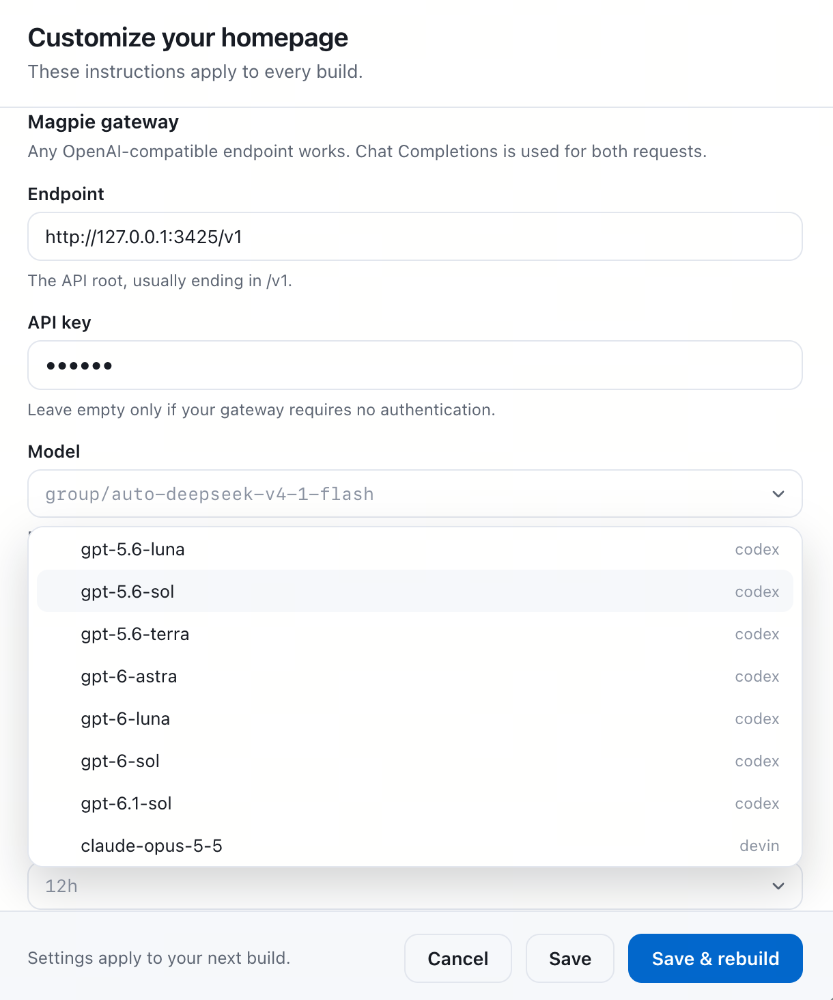

# 在 Ego 中使用 Magpie 版 AI Homepage

本 fork 只支持 OpenAI 兼容网关（默认本地 Magpie）。Anthropic Managed Agents 模式及其配置已移除，无需 Anthropic 账号。

> **给 agent 的提示词（直接复制）**
> 帮我安装这个项目：克隆 `https://github.com/vurihuang/ai-newtab`，执行 `npx pnpm@10.11.1 install && npx pnpm@10.11.1 build`，把 `apps/extension/.output/chrome-mv3` 作为「已解压的扩展程序」加载到我的 Chromium 浏览器，然后读取本机 Magpie 的 Endpoint 和 API key（Pi 存在 `~/.pi/agent/models.json` 的 `providers.magpie`；其他情况用 Magpie 启动时给出的链接），填入新标签页的连接设置并生成一次首页。

## 与 Magpie 的集成


<sub>模型列表直接读自网关，每个 ID 后面标出它的来源分组（codex、devin、ark 等）。</sub>

只需要三个字段：

| 字段 | 配置 |
| --- | --- |
| Endpoint | `http://127.0.0.1:3425/v1`，或你实际设置的 API 地址 |
| API key | 本机网关不校验，留空即可；跨网络共享的网关用 `magpie gateway-key list` 里的密钥 |
| Model | 打开设置即自动读取网关的模型列表，也可自由输入 |

终端里也可以直接查：`magpie serve` 打印 Endpoint、密钥和模型数量，`magpie models` 列出全部可选模型。扩展的下拉列表读的就是同一个列表 `/v1/models`。

- Endpoint 用 API 端口，不是 Web 管理页面端口。地址一般以 `/v1` 结尾，不要追加 `/chat/completions` 或 `/models`。
- 模型列表在打开设置、修改 Endpoint 或 API key、点击下拉框、以及在输入框中搜索时自动重新读取，不需要手动刷新。
- 列表不做缓存，内容与 `magpie models` 一致。已保存的模型 ID 若不在当前列表中，界面会提示，但仍允许使用。
- 下拉框支持键盘上下选择、回车确认、Esc 关闭，也允许直接输入任意模型 ID。
- 模型 ID 使用网关返回的原值，例如 `codex/gpt-6-astra`。不要加 Pi 中用于标识服务商的 `magpie/` 前缀。
- 模型必须支持 `/chat/completions` 文本请求。此版本不直接调用 `/responses` 或 `/messages`。
- 同一套字段也可以指向其他 OpenAI 兼容服务。

## 安装

需要 Node.js 20+，以及支持加载未打包扩展的 Chromium 浏览器。

```bash
git clone https://github.com/vurihuang/ai-newtab.git
cd ai-newtab
npx pnpm@10.11.1 install
npx pnpm@10.11.1 build
```

在 Ego 中打开 `chrome://extensions`，开启「开发者模式」，点击「加载已解压的扩展程序」，选择项目里的 `apps/extension/.output/chrome-mv3`。
如果系统文件选择器隐藏 `.output`，在 macOS 中按 `⌘⇧G`，粘贴该文件夹的完整路径。
保留项目文件夹，扩展会继续从这里加载。

## 首次生成

1. 打开新标签页，填写 Endpoint、API key 和 Model。模型列表已经自动加载。
2. 点击 **Save connection**，再点击 **Build today's homepage**。
3. 观察进度：读取浏览记录、选择页面、在浏览器中打开页面、分析内容、写出首页。

生成期间需要保持 Magpie 运行。关闭新标签页不会中断后台任务。
首次生成需要几分钟。生成期间可以先做别的事情，完成后任意新标签页都会显示结果。

## 自定义模型和首页

首次生成前、生成失败后和已有首页上都可以打开 **Settings**。
在这里修改 Endpoint、API key、模型、内容要求、排除网站和自动更新周期。

- **Save**：保存，下一次生成使用新配置。
- **Save & rebuild**：保存后立即生成。
- **Rebuild every**：自动重建周期。可以选预设，也可以直接输入：
  - 时长：`15m`、`1h`、`2d`、`1w`，或纯数字小时数（如 `12`）。
  - cron：五位表达式，最小粒度为分钟。例如 `0 9 * * *`（每天 9 点）、`0 9 * * mon`（每周一 9 点）、`*/30 8-18 * * *`（工作日每 30 分钟）。支持 `*`、范围、列表、步长和三个字母的星期／月份名称。
  - `off`：关闭自动重建。
  输入框下方会显示下一次重建时间。无法解析的值会标红提示，不会静默保存。
- 正在运行的任务继续使用启动时的连接。排除网站列表会在读取和发送页面前重新检查。
- 自动重建只在手动生成过一次之后才启动。失败后不会循环重试，而是等到下一个周期。
- **Instructions**：填写内容要求，会应用到每次生成。

内容要求示例：

> 用中文生成简洁的每日阅读页。优先关注 AI 工具、GitHub 项目和开发者资讯。
> 每条内容写一句推荐理由，并保留原始链接。使用浅色单栏布局。

## 数据和故障处理

浏览记录摘要、最多 8 个页面的清理后内容会发送给该网关及其上游模型服务。
每页最多发送 24,000 个字符，较长页面后半部分可能不会被纳入首页。
页面使用你的浏览器登录状态，因此可能包含非公开内容；可在排除列表中添加工作系统等站点。
本地网络地址始终不能作为内容源，但可以用作 Endpoint。

密钥保存在扩展的本地存储中，不写入项目源码。网关及上游服务的数据保留由其配置决定。

- **HTTP 401 / 403**：检查网关密钥与访问权限。
- **HTTP 404**：检查 Endpoint 和模型 ID。
- **模型列表读取失败**：检查 Magpie 是否运行。不支持模型列表的网关仍可手填模型 ID。
- **没有可读取的历史记录**：先在该浏览器中访问新闻、社区等站点。同一站点至少需要两次访问。
- **网页读取失败**：检查站点能否在浏览器中打开，以及排除列表是否包含它。
- **生成被截断或模型返回格式错误**：尝试其他文本模型，或调整网关里的模型输出限制。
- **定时没有触发**：检查表达式是否为五位 cron。`0 9 1 * mon` 这类同时限定「日」和「星期」的写法会被拒绝，请改用其中一种。
- **浏览器或后台 worker 中断**：需要重新生成。已保存的首页会保留。

## 开发验证

```bash
npx pnpm@10.11.1 typecheck
npx pnpm@10.11.1 test
npx pnpm@10.11.1 build
npx pnpm@10.11.1 extension:test
```

扩展测试使用独立 Chrome 配置、模拟网关和测试页面，不读取你的浏览记录，也不调用真实模型。
如 Chrome 不在默认路径，可设置 `CHROME_PATH`。

复制 `.env.example` 为 `.env`，填写 `GATEWAY_*`，可运行 `pnpm gateway:run`。
这会用测试浏览记录和公开页面调用真实网关。运行 `pnpm agent:verify` 验证生成结果能否渲染。
不要提交 `.env` 或任何实际密钥。
